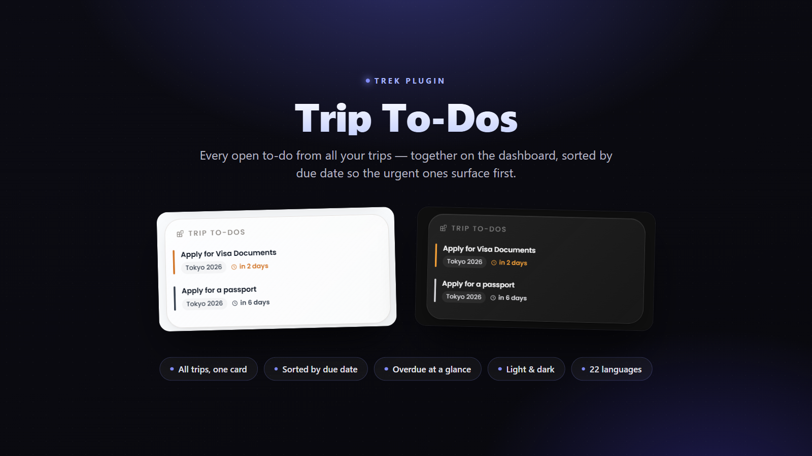

# Trip To-Dos

A TREK dashboard widget that gathers the **open to-dos from every one of your
trips** into a single card on the main screen, sorted by due date — overdue
first — so nothing slips through the cracks.

Built in response to the feature request
[mauriceboe/TREK#1522](https://github.com/mauriceboe/TREK/discussions/1522).

## What it does

TREK keeps to-dos per trip, so once you plan a few trips the open tasks scatter
across them and are easy to lose track of. This widget pulls them all together:

- **One list, all trips.** Every unchecked to-do from every trip you own or are a
  member of, shown together in the dashboard sidebar.
- **Sorted by urgency.** Dated tasks come first, earliest due at the top, so
  overdue and due-soon items surface immediately; undated tasks sit below.
- **A due-date traffic light.** Each task carries a coloured marker and a
  relative due label — *overdue* (red), *due soon* (amber), later (muted),
  *no due date* (faint) — for an at-a-glance read of what needs attention.
- **Trip context on every row.** A chip shows which trip a task belongs to, and
  clicking a task jumps straight to that trip.
- **Stays out of the way.** When everything is ticked off it shows a friendly
  "all caught up" state. It matches TREK's theme (light/dark + your accent) and
  is bilingual (English / German, following your TREK language).

The widget refreshes itself every few minutes, so ticking a task off inside a
trip is reflected on the dashboard shortly after.

## Screenshots

## Permissions

This plugin only ever **reads** your own data — it never writes, and it holds no
outbound network access.

- **`db:read:trips`** — to list the trips you own or are a member of, so it knows
  which trips to gather to-dos from (and to label each task with its trip).
- **`db:read:todos`** — to read the to-do items of those trips. Only unchecked
  (open) items are shown.

Every read is performed as **you**: TREK binds the acting user from your session
and membership-checks each trip, so the widget can only ever see to-dos you could
open yourself.

## Setup

1. Install **Trip To-Dos** from the plugin registry (or sideload the packaged
   `plugin.zip` via **Admin → Plugins → Upload**).
2. **Activate** it and approve the two read permissions above.
3. Open the **dashboard** — the *Trip To-Dos* card appears in the sidebar. That's
   it; there's nothing to configure.

Requires TREK **3.3.0 or newer** (it relies on the 3.3.0 plugin capabilities
`trips.listMine` and `todos.list`).
